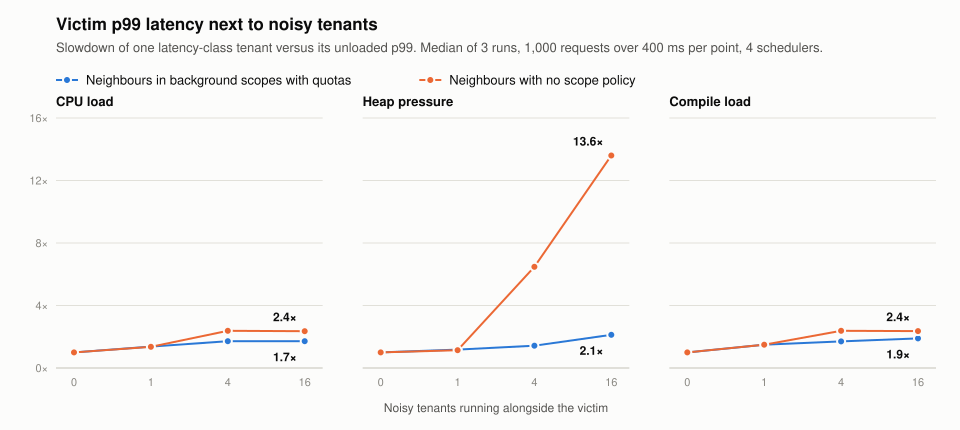

# Hyperlang

Hyperlang runs untrusted Erlang inside an Elixir host, on the same BEAM, with
no ambient authority. A guest is ordinary Erlang source. Hyperlang compiles it
through its own verifier into a BEAM module that can call only what the
program declares: its own functions, a frozen stdlib allowlist, and the host
bindings you pass in. Every run is metered for reductions, heap and wall time.
Host-owned scopes admit and prioritise the work.

The usual advice is that the BEAM cannot do this. The Erlang/OTP secure-coding
guide says there is "no built-in sand-boxing mechanism for running untrusted
Erlang code", and the EEF advises an embedded language such as Lua. So teams
reach for Luerl, WebAssembly, a restricted evaluator, or a separate node or
OS process. Part of that advice stays true: guests still share schedulers,
memory allocators, the atom table and the code server. Hyperlang changes the
rest. Guest code never becomes trusted loaded code, every atom a guest can
cause comes from a fixed set bounded by host limits, and calls outside the
declared set cannot be expressed in the generated module.

<picture>
  <source media="(prefers-color-scheme: dark)" srcset="assets/comparison_dark.svg">
  
</picture>

Measured against those alternatives on one shared 16-core host (BEAM with 4
schedulers, load average 9 to 32; method and raw data in
[`doc/COMPARISON.md`](doc/COMPARISON.md)). Against the other BEAM sandboxes
(wasmex, Luerl, Dune), Hyperlang is fastest, smallest and least disturbed by
noisy neighbours:

- **Compute:** guest code is compiled BEAM code. A guest `fib(25)` took
  0.35 ms, the same as native Erlang in a peer node or OS process (0.33 to
  0.38 ms). wasmex took 0.68 ms; Luerl, `erl_eval` and Dune took 85 to
  275 ms.
- **Memory:** an idle guest actor added 23 KiB of resident memory. A Rust
  wasmex instance added 89 KiB, a Luerl state 71 KiB and a Dune session
  109 KiB. A peer node or an OS `erl` process added 74 to 76 MiB.
- **Noisy neighbours:** next to 16 CPU-bound tenants, a victim's p99 rose
  1.4x with `Hyperlang.Scope` admission and priority classes. It rose 3.0x
  in Luerl, 7.4x in `erl_eval` and 36x in Dune. A victim in its own peer
  node rose 1.1x.
- **Tenant start:** a new tenant of a compiled program answered in 0.05 ms.
  Luerl took 0.03 ms, wasmex 0.08 ms and Dune 0.41 ms; a peer node or OS
  process took 111 to 123 ms to boot. Compiling a small program from source
  is a separate one-time step of about 17 ms.

Each call into a guest has a fixed cost: about 21 µs for a `run/4` in the
caller and 29 µs for an actor call. For many tiny calls, wasmex and Luerl in
the caller are faster.

### Code you do not fully trust, inside the VM

Agent systems run code that is only partly trusted: code the agent wrote,
tools and plugins, per-tenant logic, and the agent's own steps when untrusted
input (prompt injection, poisoned tool output) steers them. Most of it is fine.
None of it should hold ambient authority, and a bad step must not reach the
host, other tenants, or capabilities it was not given. Agents are long-lived,
stateful, concurrent and supervised, which is what BEAM processes and OTP
provide. Today the sandbox lives outside the VM: E2B uses Firecracker
microVMs, AutoGen uses Docker containers, and Cloudflare loads V8 isolates
([sources](doc/COMPARISON.md#partial-trust-in-agent-systems)). Hyperlang
runs these steps as guest actors inside the VM, as ordinary Erlang that is
capability-scoped and metered. [Running a generated tool](#running-a-generated-tool)
shows it.

### Why the guest language is Erlang

Compiling Elixir runs Elixir. Module bodies, attributes, macros, `use` and
`@before_compile` hooks all execute during compilation, with the host's
authority and no time bound. A sandbox that checks Elixir source from outside
must either forbid those constructs or run untrusted code while compiling.
Erlang source has no user code that runs at compile time. Hyperlang runs no
preprocessor, rejects `-include`, `-define`, `-compile` and `-on_load`, and
meters its own compile with a reduction budget. The sound path to sandboxed
Elixir is to run the Elixir compiler itself as a guest; see
[`doc/COMPARISON.md`](doc/COMPARISON.md#the-sound-path-to-sandboxed-elixir).

### How it compares

| | Hyperlang | Dune | Luerl | `erl_eval` + handler | wasmex | Peer node / OS process |
| --- | --- | --- | --- | --- | --- | --- |
| Guest language | Erlang | Elixir subset | Lua | Erlang | Wasm | Any |
| Ambient authority | None: rejected at compile time (P) | AST allowlist plus run-time check (S, P) | Removed Lua globals (S) | **`fun os:cmd/1` ran** (P) | Declared imports only (S) | **Full**: `os:cmd` ran (P) |
| VM atoms added by guest code | Fixed host-bounded set; 0 after warm-up (P) | Fixed pool: +1,314, then 0 (P) | +13 for 50,000 keys (P) | **+2,000 per program** (P) | None (S) | Own table (P) |
| Heap cap held (80 MB) | Yes, 39 ms (P) | **+270 MB**, 1.3 s (P) | Only if the host sets it (S) | Only if the host builds it (P) | Yes (P) | OS limits only |
| Guest keeps running after its caller dies | No (P) | No (P) | **Yes**, past `max_time` (P) | **Yes** with an unlinked spawn (P) | Until its call timeout (P) | n/a |
| Tenant start, compiled program | 0.05 ms (M) | 0.41 ms (M) | 0.03 ms (M) | 0.007 ms (M) | 0.08 ms (M) | 111–123 ms (M) |
| `fib(25)` | 0.35 ms (M) | 275 ms (M) | 85 ms (M) | 106 ms (M) | 0.68 ms, own threads (M) | 0.33–0.38 ms, own VM (M) |
| Memory per idle tenant | 23 KiB (M) | 109 KiB (M) | 71 KiB (M) | 23 KiB (M) | 89 KiB, Rust guest (M) | 74–76 MiB (M) |
| Guest actors and messages | `gen_server`, `gen_statem`, channels (S) | No processes (S) | No (S) | No | No | Full OTP (S) |

P: a probe we ran. M: a measurement. S: the project's source or docs. Each
cell is backed in [`doc/COMPARISON.md`](doc/COMPARISON.md). wasmex and child
VMs run guest code on their own threads, so compare their compute times with
care.

Guests share the VM's schedulers, allocators, garbage collector and code
server; the [threat model](#threat-model) states what that leaves.

### Running a generated tool

An agent wrote this tool at run time. Its only authority is the
`search:query/1` binding the host declares. A step that reaches for the
operating system fails to compile, and a step that never ends is stopped by
its own budget.

<!-- hyperlang:example run -->
```elixir
defmodule Readme.Search do
  @behaviour Hyperlang.Binding

  @impl true
  def exports, do: [query: 1]

  @impl true
  def call(%{docs: docs}, :query, [term]), do: Enum.filter(docs, &String.contains?(&1, term))
end

manifest = %{bindings: %{"search" => Readme.Search}, terms: %{public: :erlang}}

spec = %{
  bindings: %{"search" => {Readme.Search, %{docs: ["BEAM schedulers", "BEAM atoms are not collected"]}}},
  policy: %{max_reductions: 1_000_000, wall_ms: 100, heap_words: 100_000}
}

tool = ~S"""
-module(tool).
-export([result/1]).
result(Term) -> [D || D <- search:query(Term), byte_size(D) < 20].
"""

{:ok, program} = Hyperlang.program(%{entry: "tool.erl", files: %{"tool.erl" => tool}, manifest: manifest})
{:ok, ["BEAM schedulers"], _meta} = Hyperlang.run(spec, program, :entry, ["BEAM"])

shell = "-module(shell).\n-export([result/1]).\nresult(Cmd) -> os:cmd(Cmd).\n"
{:error, [%{category: :verify} | _]} =
  Hyperlang.program(%{entry: "shell.erl", files: %{"shell.erl" => shell}, manifest: manifest})

loop = "-module(loop).\n-export([result/1]).\nresult(X) -> result(X).\n"
{:ok, looping} = Hyperlang.program(%{entry: "loop.erl", files: %{"loop.erl" => loop}, manifest: manifest})
{:error, %{category: :reduction_watchdog}} = Hyperlang.run(spec, looping, :entry, [0])
```

## Hyperlang 101

If you know Cloudflare Workers, the model will feel familiar: a program is a
Worker script, a run is a request, bindings are `env`, and a callback actor is
a Durable Object. This guide walks through each Workers concept and shows the
Hyperlang equivalent next to it. The JavaScript blocks are Cloudflare
reference code for comparison. Every Elixir block runs as written: the test
suite extracts and executes them (`test/readme_examples_test.exs`).

The security contract is [`doc/SECURITY_SPECIFICATION.md`](doc/SECURITY_SPECIFICATION.md),
and [`SECURITY.md`](SECURITY.md) explains how to report a vulnerability.
For an OS-scale host built on Hyperlang, see the companion project
hyperbob_os, a BEAM port of the Inferno OS that runs its userland as
Hyperlang guests.

## Install

Add `{:hyperlang, "~> 0.1.0"}` to the `deps` list in your `mix.exs`, then
run `mix deps.get`.

Hyperlang needs Erlang/OTP 29 (minimum and tested release) and Elixir 1.20
or later. The stdlib allowlist and the vendored OTP sources are pinned to
OTP 29; later OTP releases are untested.

## Threat model

Hyperlang enforces authority isolation for untrusted guest source inside one
VM. A guest cannot reach any function, process, port, file, atom or code path
that its program and run do not grant. The compiler lowers and checks every
call before the module exists, each run is metered for reductions, heap and
wall time, and every term that crosses the door is sanitized.

`Hyperlang.Scope` adds resource isolation between tenants. Each scope has its
own admission limits, quotas and priority class, and node-wide admission
counts only runnable guest work, so blocked guests hold no capacity. Latency
scopes keep a reserved slot and wake first. An isolation verification of this
release measured the effect on a victim tenant:

<picture>
  <source media="(prefers-color-scheme: dark)" srcset="assets/isolation_noisy_neighbours_dark.svg">
  
</picture>

These historical measurements precede runnable-only admission. Each point is
the p99 of 1,000 requests from one latency-class tenant on a
node with 8 schedulers, divided by that tenant's p99 with no neighbours. Each noisy tenant has its
own scope and, over and over, either spins a CPU-bound loop, grows its heap
until its heap limit kills the run, or compiles a new guest module. With
scope controls on, the victim runs in the `:latency` class and the
neighbours in `:background`.

| Noisy tenants | 0 | 1 | 4 | 16 |
|---|---:|---:|---:|---:|
| CPU, no scope controls | 1.0x | 1.0x | 3.8x | 16.8x |
| CPU, `Hyperlang.Scope` | 1.0x | 0.9x | 0.9x | 1.3x |
| Heap, no scope controls | 1.0x | 1.4x | 7.7x | 14.8x |
| Heap, `Hyperlang.Scope` | 1.0x | 1.0x | 1.1x | 2.3x |
| Compile, no scope controls | 1.0x | 1.1x | 4.1x | 5.4x |
| Compile, `Hyperlang.Scope` | 1.0x | 1.1x | 1.2x | 1.0x |

The resource controls provide these guarantees:

- Each run has fresh reduction accounting. A spawned run's limits group is
  destroyed when the run ends: 10,000 runs leave 0 groups, processes, ports,
  ETS tables or file descriptors behind. An actor's callbacks, and one
  host's in-caller runs, share one limits group per process: its usage
  restarts with every run, and the process's exit destroys it.
- Guest children owned by a run are killed when the run ends.
- Timer quotas and handles belong to a host-selected scope. One scope cannot
  read or cancel another scope's timers.
- Channels, buffers and broker heaps are charged against scope quotas
  (1,024 channels per scope by default).
- OTP actor status and crash reports never show binding state or policy
  secrets, whatever `format_status` the guest defines.
- Internal fun application rejects host funs.

Guests share the VM's schedulers, allocators, garbage collector and code
server, and a few native calls cannot be interrupted. Hosts that need hard
latency or memory bounds against hostile tenants add OS or node isolation.
The [security specification](doc/SECURITY_SPECIFICATION.md) lists the full
contract and its known limitations.

## Workers and Hyperlang at a glance

The left column is Cloudflare Workers code. The right column is the
equivalent Hyperlang guest, which is plain Erlang. Authority that Workers
receive through `env` arrives in Hyperlang as static calls to named bindings
(`kv:get/1`, `storage:put/2`). The host declares those bindings once and
supplies them at run time. The sections after this one show the host side of
each pair and run it. Each Erlang snippet here is copied from one of those
runnable examples, and the test suite checks that the copies match.

<table>
<tr><th>Cloudflare Workers (JavaScript)</th><th>Hyperlang guest (Erlang)</th></tr>
<tr><td colspan="2"><b>Entrypoint</b>: <code>fetch</code> becomes <code>result/1</code></td>
</tr>
<tr>
<td>

```js
export default {
  async fetch(request, env, ctx) {
    const { name } = await request.json();
    return Response.json({ greeting: `hello ${name}` });
  },
};
```

</td><td>

<!-- hyperlang:example mirror -->
```erlang
-module(hello).
-export([result/1]).

result(#{<<"name">> := Name}) ->
    #{<<"greeting">> => <<"hello ", Name/binary>>}.
```

</td>
</tr>
<tr><td colspan="2"><b>RPC method</b>: a <code>WorkerEntrypoint</code> method becomes a manifest-declared export</td>
</tr>
<tr>
<td>

```js
export class Calc extends WorkerEntrypoint {
  add(a, b) {
    return a + b;
  }
}
```

</td><td>

<!-- hyperlang:example mirror -->
```erlang
-module(calc).
-export([add/2]).
add(A, B) -> A + B.
```

</td>
</tr>
<tr><td colspan="2"><b>KV binding</b>: <code>env.KV</code> becomes the <code>kv</code> binding</td>
</tr>
<tr>
<td>

```js
export default {
  async fetch(request, env) {
    await env.KV.put("greeting", "hi");
    return new Response(await env.KV.get("greeting"));
  },
};
```

</td><td>

<!-- hyperlang:example mirror -->
```erlang
-module(greet).
-export([result/1]).
result(Key) -> ok = kv:put(Key, <<"hi">>), kv:get(Key).
```

</td>
</tr>
<tr><td colspan="2"><b>Secret</b>: <code>env.API_TOKEN</code> stays inside the binding's host state, and the guest never sees it</td>
</tr>
<tr>
<td>

```js
export default {
  async fetch(request, env) {
    return new Response(await sign(env.API_TOKEN, "payload"));
  },
};
```

</td><td>

<!-- hyperlang:example mirror -->
```erlang
-module(signed).
-export([result/1]).
result(P) -> signer:sign(P).
```

</td>
</tr>
<tr><td colspan="2"><b>Logging</b>: <code>console.log</code> becomes <code>io:format</code>, returned to the host in <code>meta.stdout</code></td>
</tr>
<tr>
<td>

```js
export default {
  async fetch(request) {
    console.log("pricing", "A1");
    return new Response("42");
  },
};
```

</td><td>

<!-- hyperlang:example mirror -->
```erlang
-module(price).
-export([result/1]).
result(Sku) -> io:format("pricing ~s~n", [Sku]), 42.
```

</td>
</tr>
<tr><td colspan="2"><b>Durable Object</b>: a class with <code>ctx.storage</code> becomes a gen_server callback module with a <code>storage</code> binding</td>
</tr>
<tr>
<td>

```js
export class Counter extends DurableObject {
  constructor(ctx, env) {
    super(ctx, env);
    ctx.blockConcurrencyWhile(async () => {
      this.n = (await ctx.storage.get("n")) ?? 0;
    });
  }
  async inc() {
    this.n += 1;
    await this.ctx.storage.put("n", this.n);
    return this.n;
  }
}
```

</td><td>

<!-- hyperlang:example mirror -->
```erlang
-module(counter).
-behaviour(gen_server).
-export([init/1, handle_call/3]).

init(_Id) -> {ok, storage:get(<<"n">>, 0)}.

handle_call(<<"inc">>, _From, N) ->
    ok = storage:put(<<"n">>, N + 1),
    {reply, N + 1, N + 1}.
```

</td>
</tr>
</table>

## The door

The whole public API is four functions:

| Function | Role |
| --- | --- |
| `Hyperlang.program/1` | Compile a source value into an immutable `%Hyperlang.Program{}`. |
| `Hyperlang.program/2` | Return a program cached under your key; compile on a miss. |
| `Hyperlang.run/4` | Run one export of a program with the authority in a spec. |
| `Hyperlang.module/1` | Return the program's confined OTP callback module. |

`Hyperlang.Binding` is the behaviour for host capabilities, and
`Hyperlang.Test` is the test kit.

## A Worker entrypoint is `result/1` plus `run/4`

A Worker exports `fetch`. A Hyperlang program exports `result/1`, and the host
calls it with `Hyperlang.run(spec, program, :entry, [input])`.

```js
// Cloudflare Worker
export default {
  async fetch(request, env, ctx) {
    const { name } = await request.json();
    return Response.json({ greeting: `hello ${name}` });
  },
};
```

<!-- hyperlang:example run -->
```elixir
# Hyperlang: guest Erlang + host Elixir
{:ok, program} =
  Hyperlang.program(%{
    entry: "hello.erl",
    files: %{
      "hello.erl" => ~S"""
      -module(hello).
      -export([result/1]).

      result(#{<<"name">> := Name}) ->
          #{<<"greeting">> => <<"hello ", Name/binary>>}.
      """
    },
    manifest: %{terms: %{public: :erlang}}
  })

{:ok, %{<<"greeting">> => "hello Ada"}, meta} =
  Hyperlang.run(%{}, program, :entry, [%{<<"name">> => "Ada"}])

%{stdout: [], reductions: _, wall_us: _} = meta
```

The value comes back as a plain term. Inputs and outputs cross a sanitizer:
binaries, numbers, lists, tuples, maps, and allowlisted atoms pass; pids,
ports, references, and funs do not. `terms: %{public: :erlang}` selects the
Erlang term profile used throughout this guide. Without it, the default
profile projects terms to a JSON-safe shape (binaries become
`%{"$binary" => base64}`), which suits hosts that serialize results.

A program can also declare named exports, the analog of RPC methods on a
`WorkerEntrypoint`. Only exports the manifest declares are callable; a source
`-export` attribute alone grants nothing.

<!-- hyperlang:example run -->
```elixir
{:ok, program} =
  Hyperlang.program(%{
    entry: "calc.erl",
    files: %{"calc.erl" => "-module(calc).\n-export([add/2]).\nadd(A, B) -> A + B.\n"},
    manifest: %{
      terms: %{public: :erlang},
      exports: %{functions: %{"add" => %{function: "add", arity: 2}}}
    }
  })

{:ok, 3, _meta} = Hyperlang.run(%{}, program, "add", [1, 2])
```

## `env` bindings and wrangler config are `Hyperlang.Binding` and manifest `bindings`

In Workers, `wrangler.jsonc` declares a binding by name and the code calls
`env.KV.get(key)`. In Hyperlang, a binding is a trusted host module. The
program manifest names it once, and guest code calls it as a static module
call, `kv:get(Key)`.

```js
// wrangler.jsonc: { "kv_namespaces": [{ "binding": "KV", "id": "..." }] }
export default {
  async fetch(request, env) {
    return new Response(await env.KV.get("greeting"));
  },
};
```

<!-- hyperlang:example run -->
```elixir
defmodule Readme.KV do
  @behaviour Hyperlang.Binding

  @impl true
  def exports, do: [get: 1, put: 2]

  @impl true
  def call(%{table: table}, :get, [key]) do
    case :ets.lookup(table, key) do
      [{^key, value}] -> value
      [] -> :undefined
    end
  end

  def call(%{table: table}, :put, [key, value]) do
    true = :ets.insert(table, {key, value})
    :ok
  end
end

{:ok, program} =
  Hyperlang.program(%{
    entry: "greet.erl",
    files: %{
      "greet.erl" => """
      -module(greet).
      -export([result/1]).
      result(Key) -> ok = kv:put(Key, <<"hi">>), kv:get(Key).
      """
    },
    manifest: %{
      bindings: %{"kv" => Readme.KV},
      terms: %{public: :erlang, allowed_atoms: [:ok, :undefined]}
    }
  })

table = :ets.new(:readme_kv, [:public])
spec = %{bindings: %{"kv" => {Readme.KV, %{table: table}}}}

{:ok, "hi", _meta} = Hyperlang.run(spec, program, :entry, ["greeting"])
```

`exports/0` is read once, by `Hyperlang.program/1`. The resulting MFA set
(`kv:get/1`, `kv:put/2`) is pinned into the program and its hash. A call to
any other `kv:` function is a compile error. At run time, `spec.bindings`
must name exactly the declared bindings with the same modules, or the run
fails before the guest starts.

An export may carry options: `{:get, 1, limits: %{max_binary_bytes: 4096}}`
caps argument and return sizes, and `{:now_ms, 0, nondeterministic: true}`
marks a call that the manifest must allow with
`capabilities: %{nondeterminism: true}`.

## Secrets and vars live in binding state

A Worker reads secrets from `env.API_TOKEN`. In Hyperlang, the binding's
`state` is the place for them. State goes to `call/3` and never reaches the
guest.

```js
export default {
  async fetch(request, env) {
    const sig = await sign(env.API_TOKEN, "payload");
    return new Response(sig);
  },
};
```

<!-- hyperlang:example run -->
```elixir
defmodule Readme.Signer do
  @behaviour Hyperlang.Binding

  @impl true
  def exports, do: [sign: 1]

  @impl true
  def call(%{token: token}, :sign, [payload]),
    do: :crypto.mac(:hmac, :sha256, token, payload) |> Base.encode16(case: :lower)
end

{:ok, program} =
  Hyperlang.program(%{
    entry: "signed.erl",
    files: %{"signed.erl" => "-module(signed).\n-export([result/1]).\nresult(P) -> signer:sign(P).\n"},
    manifest: %{bindings: %{"signer" => Readme.Signer}, terms: %{public: :erlang}}
  })

spec = %{bindings: %{"signer" => {Readme.Signer, %{token: "s3cret"}}}}
{:ok, signature, _meta} = Hyperlang.run(spec, program, :entry, ["payload"])
64 = byte_size(signature)
```

## `console.log` and Tail Workers are `io:format` and `meta.stdout`

Guest `io:format` output is captured, sanitized, and bounded, then returned
with the result. A host can forward it to its own logger, which is the role a
Tail Worker plays.

```js
export default {
  async fetch(request) {
    console.log("pricing", "A1");
    return new Response("42");
  },
};
```

<!-- hyperlang:example run -->
```elixir
{:ok, program} =
  Hyperlang.program(%{
    entry: "price.erl",
    files: %{
      "price.erl" => ~S"""
      -module(price).
      -export([result/1]).
      result(Sku) -> io:format("pricing ~s~n", [Sku]), 42.
      """
    },
    manifest: %{terms: %{public: :erlang}}
  })

{:ok, 42, %{stdout: ["pricing A1\n"], reductions: reductions}} =
  Hyperlang.run(%{}, program, :entry, ["A1"])

true = reductions > 0
```

## CPU and memory limits are reductions, heap, and wall time

Workers cap CPU time and memory per request. Hyperlang caps reductions
(`max_reductions`), heap words (`heap_words`), and wall time
(`wall_ms`) per run, set in `spec.policy`. A run that crosses a limit returns
a sanitized error with a fixed category.

<!-- hyperlang:example run -->
```elixir
{:ok, program} =
  Hyperlang.program(%{
    entry: "work.erl",
    files: %{
      "work.erl" => """
      -module(work).
      -export([result/1]).
      result(<<"spin">>) -> spin();
      result(N) -> N.
      spin() -> spin().
      """
    }
  })

{:error, %{category: :reduction_watchdog}} =
  Hyperlang.run(%{policy: %{max_reductions: 100_000}}, program, :entry, ["spin"])

{:error, %{category: :timeout}} =
  Hyperlang.run(%{policy: %{max_reductions: nil, wall_ms: 50}}, program, :entry, ["spin"])

{:ok, 7, _meta} = Hyperlang.run(%{policy: %{heap_words: 200_000}}, program, :entry, [7])
```

Limits are counted in reductions, not CPU milliseconds, so the same program
and input hit the same limit on every run.

Compilation follows the same rule. The manifest limit
`max_compile_reductions` caps the reductions of the compile worker (parse,
verification, code generation and the OTP compiler), and `max_compile_ms` is a
wall-clock backstop for work that does not execute reductions. A source is
admitted or rejected the same way on an idle and on a loaded host.

## Worker Loader `LOADER.get` is `Hyperlang.program(key, loader)`

The Worker Loader API fetches a dynamic Worker by id and calls a factory only
on a miss. `Hyperlang.program/2` does the same with a caller-owned key.

```js
const worker = env.LOADER.get("tenant-acme-v3", async () => ({
  mainModule: "main.js",
  modules: { "main.js": await fetchSource("acme") },
}));
```

<!-- hyperlang:example run -->
```elixir
loader = fn ->
  %{entry: "acme.erl", files: %{"acme.erl" => "-module(acme).\n-export([result/1]).\nresult(N) -> N * 2.\n"}}
end

{:ok, program} = Hyperlang.program({:tenant, "acme", 3}, loader)
{:ok, ^program} = Hyperlang.program({:tenant, "acme", 3}, fn -> raise "not called on a hit" end)
{:ok, 10, _meta} = Hyperlang.run(%{}, program, :entry, [5])
```

Programs are content-addressed: the same source and manifest always produce
an equal program value.

## A Durable Object is a callback actor plus a storage binding

A Durable Object is a single-threaded object with durable storage. Hyperlang
builds the same shape from parts you already have:

- `Hyperlang.module(program)` is a confined `GenServer` callback module. The
  actor runs one callback at a time, so it has an input gate without any
  extra machinery.
- Storage is an ordinary binding passed in the spec, for example
  `{MyHost.Storage, %{ns: actor_id}}`. Binding calls are synchronous inside
  the callback, so a write-through storage binding returns only after the
  write is durable. That is the output gate.
- In-memory state is a cache. `init/1` reloads it from storage, so an actor
  that stops or crashes restarts with the state its storage holds. This plays
  the role of `blockConcurrencyWhile` in a constructor.
- Limits from `spec.policy` apply to every callback with no host wiring:
  `wall_ms` and `max_reductions` per callback, `rate` and `ceiling` for the
  actor's lifetime.

```js
export class Counter extends DurableObject {
  constructor(ctx, env) {
    super(ctx, env);
    ctx.blockConcurrencyWhile(async () => {
      this.n = (await ctx.storage.get("n")) ?? 0;
    });
  }
  async inc() {
    this.n += 1;
    await this.ctx.storage.put("n", this.n);
    return this.n;
  }
}
```

<!-- hyperlang:example run -->
```elixir
defmodule Readme.Storage do
  @behaviour Hyperlang.Binding

  @impl true
  def exports, do: [get: 2, put: 2]

  @impl true
  def call(%{table: table, ns: ns}, :get, [key, default]) do
    case :ets.lookup(table, {ns, key}) do
      [{_key, value}] -> value
      [] -> default
    end
  end

  def call(%{table: table, ns: ns}, :put, [key, value]) do
    true = :ets.insert(table, {{ns, key}, value})
    :ok
  end
end

{:ok, program} =
  Hyperlang.program(%{
    entry: "counter.erl",
    files: %{
      "counter.erl" => ~S"""
      -module(counter).
      -behaviour(gen_server).
      -export([init/1, handle_call/3]).

      init(_Id) -> {ok, storage:get(<<"n">>, 0)}.

      handle_call(<<"inc">>, _From, N) ->
          ok = storage:put(<<"n">>, N + 1),
          {reply, N + 1, N + 1}.
      """
    },
    manifest: %{
      result: %{name: "init", arity: 1},
      terms: %{public: :erlang, allowed_atoms: [:ok]},
      bindings: %{"storage" => Readme.Storage}
    }
  })

table = :ets.new(:readme_storage, [:public])
spec = %{bindings: %{"storage" => {Readme.Storage, %{table: table, ns: "counter-1"}}}}

{:ok, pid} = GenServer.start(Hyperlang.module(program), {spec, "counter-1"})
1 = GenServer.call(pid, "inc")
2 = GenServer.call(pid, "inc")
:ok = GenServer.stop(pid)

# A new actor for the same id reloads from storage in init/1.
{:ok, pid} = GenServer.start(Hyperlang.module(program), {spec, "counter-1"})
3 = GenServer.call(pid, "inc")
:ok = GenServer.stop(pid)
```

The host owns everything around the actor: the id-to-process registry
(`idFromName`), when to start and stop actors, and where storage lives. An
alarm is another binding: the guest asks the host to record one, and the host
delivers it later as a message. The default guest profile has no timers.

## `vitest-pool-workers` is `Hyperlang.Test`

`Hyperlang.Test` compiles guests, fakes bindings, runs exports, and starts
actors, using only the public door. A fake binding is a plain map of
functions; the kit backs it with a generated `Hyperlang.Binding` module.

```js
// vitest.config.ts declares bindings; tests import from "cloudflare:test"
import { env, SELF } from "cloudflare:test";
it("prices an item", async () => {
  const res = await SELF.fetch("https://example.com/?sku=A1");
  expect(await res.text()).toBe("42");
});
```

<!-- hyperlang:example run -->
```elixir
import Hyperlang.Test

source = "-module(shop).\n-export([result/1]).\nresult(Sku) -> io:format(\"sku~n\"), catalog:price(Sku).\n"
catalog = %{"catalog" => %{price: fn "A1" -> 42 end}}
manifest = %{terms: %{public: :erlang}}

42 = run!(source, :entry, ["A1"], bindings: catalog, manifest: manifest)

{:ok, 42, meta} = run(source, :entry, ["A1"], bindings: catalog, manifest: manifest)
assert_stdout(meta, "sku\n")

program = program!(source, Map.put(manifest, :bindings, catalog))
{:ok, 42, _meta} = run(program, :entry, ["A1"], bindings: catalog)
```

`start_actor!/3` starts a callback actor with `bindings:` and `policy:` the
same way.

## Where Hyperlang deliberately differs

- **No async/await, no `ctx.waitUntil`.** Binding calls block inside the
  metered call, so nothing interleaves and no input-gate machinery is needed.
  Background work belongs to the host: record a durable intent, or have the
  actor cast to itself.
- **No ambient `fetch` or outbound network.** A guest has no network unless a
  binding grants it, and that binding does its own checks host-side.
- **No `env` value in the guest.** Bindings are static calls such as
  `kv:get(K)`, never a term the guest can store, pass, or call dynamically.
  The verifier rejects dynamic `M:F(...)` calls.
- **No persisted live capability stubs.** A guest cannot save a binding and
  redeem it later. Authority is re-supplied by the host on every run.
- **Reductions, not CPU milliseconds.** Reduction limits are deterministic
  enough to test exactly.
- **Allowlisted atoms.** Atoms are a bounded, program-declared universe
  (`terms.allowed_atoms`). A run's `policy.atoms` may narrow that set but
  never widen it. Workers have no atom table to protect; the BEAM does.
- **No WebSocket hibernation.** BEAM processes are cheap; an idle actor can
  simply be stopped and restarted from storage.
- **Child isolates are a host concern.** Only the host starts programs and
  actors; a guest cannot spawn another program.

## Standard library calls

Hyperlang admits a frozen allowlist of Erlang/OTP stdlib functions. Allowed
calls are the real OTP functions, behind argument and result sanitization.

<!-- hyperlang:example run -->
```elixir
{:ok, program} =
  Hyperlang.program(%{
    entry: "std.erl",
    files: %{
      "std.erl" => ~S"""
      -module(std).
      -export([result/1]).
      result(_) ->
          {lists:sum([1, 2, 3]),
           maps:get(<<"x">>, #{<<"x">> => 7}),
           re:replace(<<"banana">>, <<"a">>, <<"x">>, [global, {return, binary}])}.
      """
    },
    manifest: %{terms: %{public: :erlang}}
  })

{:ok, {6, 7, "bxnxnx"}, _meta} = Hyperlang.run(%{}, program, :entry, [nil])
```

Live clocks and entropy (`erlang:system_time/0,1`, `erlang:monotonic_time/0,1`,
`calendar:universal_time/0`, `rand:mwc59_seed/0`, `sys:millisec/0`,
local-time-zone conversions)
require `capabilities: %{nondeterminism: true}`. Ambient authority such as
`os:*`, raw `file:*`, ports, ETS, code loading, dynamic `apply`, and NIF
loading is rejected at compile time.

`io:format/*`, `io_lib:format/*`, and float formatting run through vendored,
pinned OTP formatting code behind Hyperlang wrappers, so output stays bounded,
cannot mint atoms, and never renders a fun. Raw OTP JSON encoders are rejected; a host that needs
JSON provides it as a binding.

## Filesystem capability

A manifest can enable a mediated virtual filesystem. Guest code then uses
standard `file:*` and `filelib:*` calls against virtual paths; there is no
guest-visible filesystem module. These examples run against a manifest with a
readable `/data` mount and a writable `/work` mount (see the test that
consumes `hyperlang:example compile` markers):

<!-- hyperlang:example compile -->
```erlang
result(_) ->
    {ok, Bin} = file:read_file("/data/input.txt"),
    ok = file:write_file("/work/output.txt", Bin),
    #{<<"copied">> => Bin}.
```

<!-- hyperlang:example compile -->
```erlang
result(_) ->
    {ok, Names} = file:list_dir("/data"),
    lists:sort(Names).
```

The supported `file:*` subset is sequential and virtual-path based:
`read_file/1`, `write_file/2,3`, `list_dir/1`, `make_dir/1`, `del_dir/1`,
`delete/1`, `rename/2`, `read_file_info/1`, `read_link_info/1`, and, with
handle compatibility enabled, `open/2`, `read/2`, `write/2`, and `close/1`.
Handles are opaque guest terms. Mount permissions, byte limits, and entry
limits are enforced on every call. A host can instead supply a Plan 9 style
syscall facade through `sys:*` with `spec.syscall`.

Existing symlinks in host-backed mounts follow standard host semantics, and
guests cannot create links. Do not mount a host directory whose symlinks point
to paths the guest must not read; use memory or snapshot mounts for strict
fixtures.

## Run the tests

```bash
mix test
```

The opt-in isolation stress probes are described in
[`CONTRIBUTING.md`](CONTRIBUTING.md).

## License

Hyperlang is licensed under the Apache License, Version 2.0. See
[`LICENSE`](LICENSE) and [`NOTICE`](NOTICE), which credits the vendored
Erlang/OTP sources.
